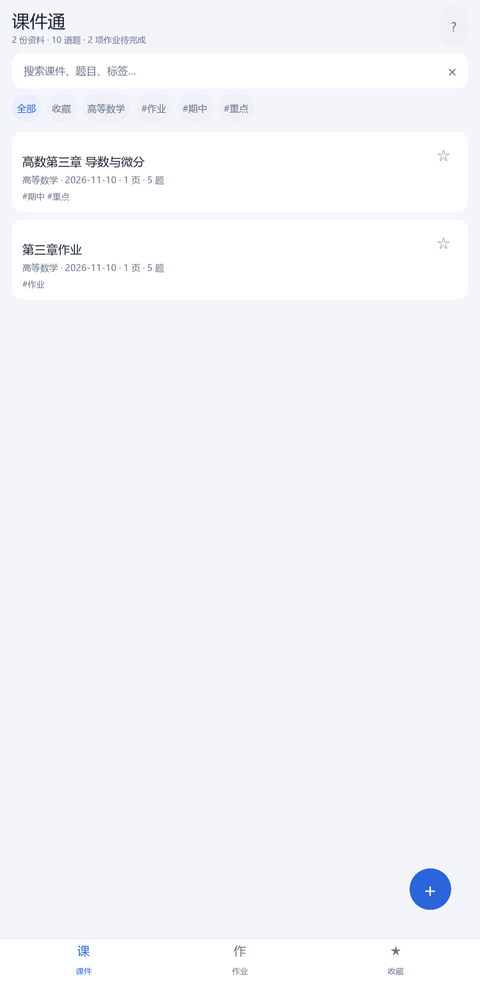
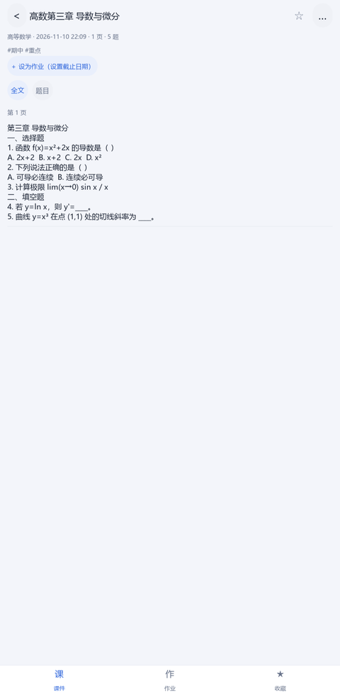
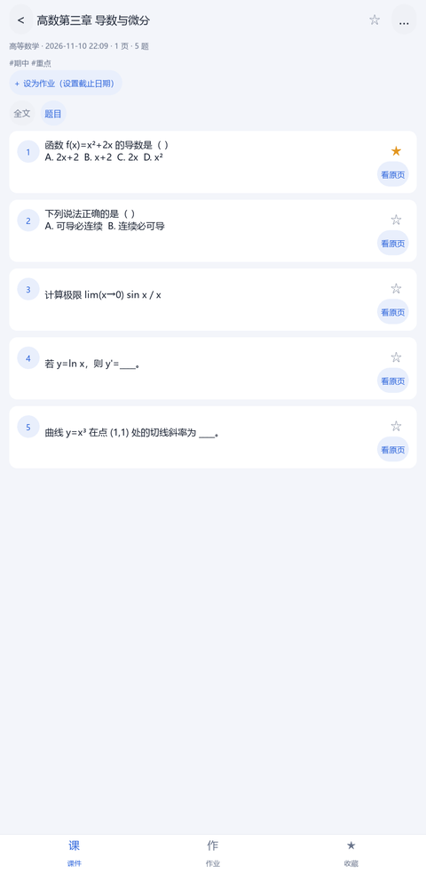
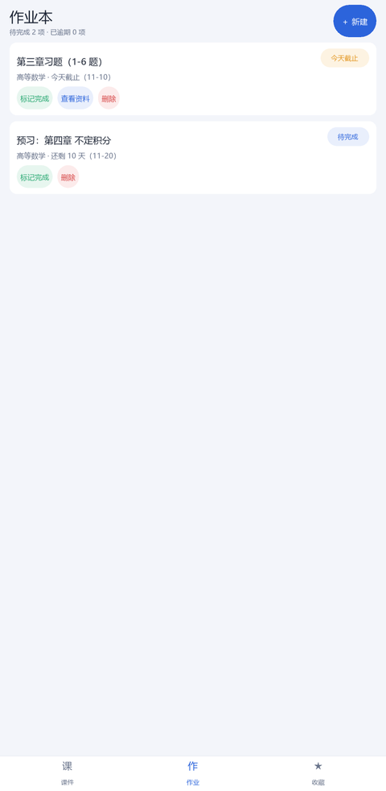
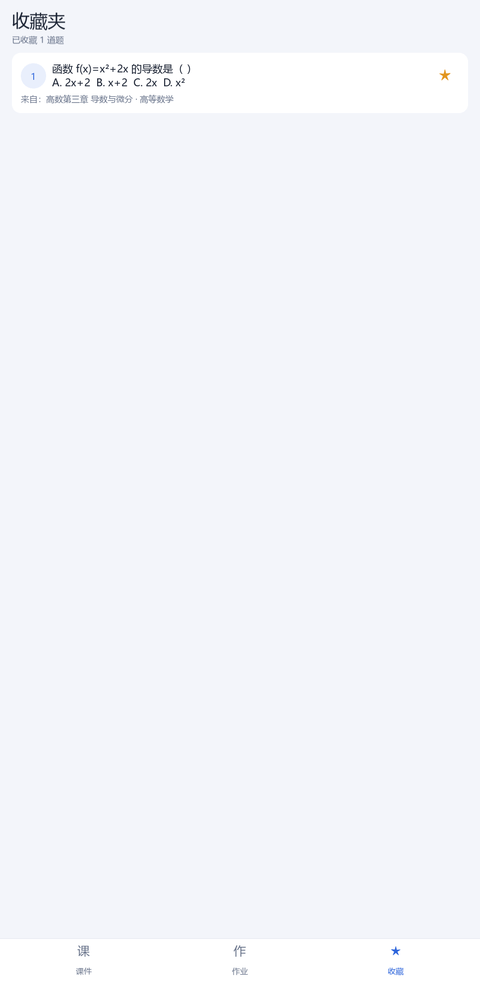
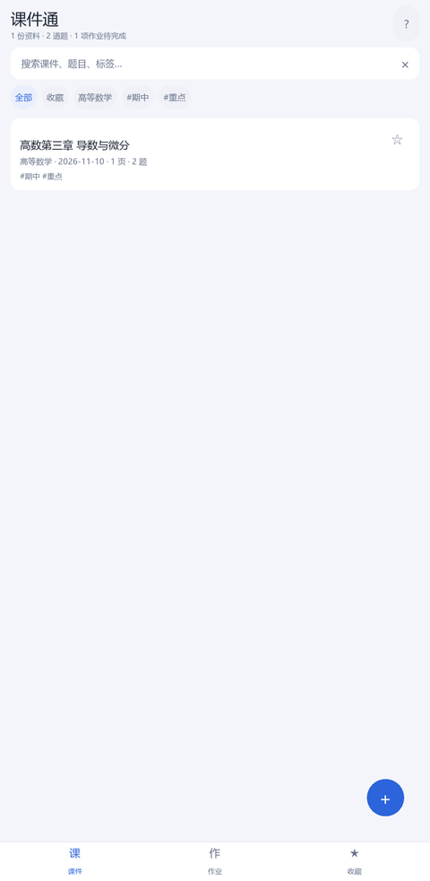

# 课件通（CourseKit）—— 拍照课件 / 作业 PDF → 文字与题库，离线复习整理

> 手机拍课件、上传作业 PDF，自动提取文字并按题号切分成一道道题；
> 按课程、标签、收藏整理，支持作业截止日期提醒，导出 Markdown / Word 打印复习。
>
> **文字识别全部在本地完成，图片与文字不会上传任何服务器。**

| 课件库 | 资料详情（全文） | 题目列表 |
|---|---|---|
|  |  |  |

| 作业本 | 收藏夹 | 导入面板 |
|---|---|---|
|  |  |  |

## 功能一览

| 功能 | 说明 |
|---|---|
| 拍照 / 相册 / PDF 导入 | 手机直接调用系统相机拍照；电子版 PDF 优先读取文字层（更准）；扫描版 PDF 自动逐页 OCR |
| 全文 + 自动切题 | 识别全文，并按 `1.` `1、` `（1）` `一、` `①` 等题号切分题目，选项自动归入对应题 |
| 按课程分类 | 导入时填科目，首页按科目筛选 |
| 标签整理 | 自定义标签（如 期中、重点、易错），首页标签筛选 |
| 收藏夹 | 资料和单道题都能收藏，收藏页集中刷重点题 / 错题 |
| 全文搜索 | 标题、全文、题目、科目都参与搜索，中文子串匹配 |
| 作业管理 | 资料可一键设为作业并设置截止日期；逾期 / 今天 / 剩余天数提醒 |
| 导出 | Markdown（笔记软件）、Word `.docx`（打印 / 交作业）、纯文本 |
| 离线 | 电脑用 RapidOCR，安卓用 Google ML Kit 随包模型，均不联网 |

## 快速开始（电脑端，已验证）

```bash
# Python 3.10+（开发验证用 3.11）
python -m venv .venv
.venv\Scripts\activate            # Windows；macOS/Linux 用 source .venv/bin/activate
pip install -i https://pypi.tuna.tsinghua.edu.cn/simple -r requirements.txt
python main.py
```

首次识别会加载本地 OCR 模型（约 2~5 秒），之后复用。默认数据保存在项目下的 `data/`。

如果 Kivy 启动时报 `PermissionError: ...\.kivy`（受限环境无法写用户目录），先设置：

```powershell
$env:KIVY_HOME = "$PWD\.kivy"; python main.py
```

> pip 安装慢时建议始终加 `-i https://pypi.tuna.tsinghua.edu.cn/simple`。

## 安卓 APK（GitHub Actions 云端打包）

本机是 Windows 且没有 Android 构建链；**ARM 平板/开发板也无法运行 Android SDK 构建工具**（aapt2 等只有 x86_64 版本）。因此 APK 用 GitHub Actions 的 x86_64 Linux 环境打包：

1. 在 GitHub 新建仓库，把本项目全部文件推送上去（不要提交 `.venv/`、`data/`、`build_artifacts/`）。
2. 打开仓库 **Actions → 构建 Android APK → Run workflow**。
3. 首次构建约 40~90 分钟（需下载 Android SDK/NDK，之后有缓存会快很多）。
4. 构建完成后在该次运行页面底部下载 `coursekit-debug-apk` 产物 → 安装到手机（允许“未知来源”）。

详细步骤与常见问题：[`docs/ANDROID_BUILD.md`](docs/ANDROID_BUILD.md)。
打包配置：[`buildozer.spec`](buildozer.spec)（ML Kit 中文随包离线模型、arm64-v8a）。

**注意**：APK 里离线 OCR 用 Google ML Kit，而不是电脑端的 RapidOCR——RapidOCR 依赖的 onnxruntime 没有安卓 Python 包，无法打包进 APK。

## 使用流程

1. **导入**：首页右下角「＋」→ 拍照 / 相册 / PDF，可选填科目。
2. **识别**：App 自动 OCR、切题，几秒后进入资料详情。
3. **复习**：首页按科目 / 标签 / 收藏筛选；资料页切换「全文 / 题目」；题目可「看原页」对照。
4. **标记**：资料右上角 ☆ 收藏整份；每道题右侧 ☆ 收藏单题（进「收藏」页集中复习）。
5. **作业**：资料详情点「＋ 设为作业」填截止日期；在「作业」页看逾期/剩余天数，完成后标记。
6. **导出**：资料页「…」→ 导出 Markdown / Word / 文本；安卓保存到手机「下载」目录。

## 目录结构

```
课件通/
├─ main.py                  # 启动入口
├─ app/                     # Kivy 界面层（手机 / 电脑共用）
│  ├─ app.py                # App 主类：导航、导入导出、提示
│  ├─ screens.py            # 首页 / 作业本 / 收藏夹 / 资料详情
│  ├─ cards.py              # 资料卡、题目卡、作业卡
│  ├─ modals.py             # 进度、导入、文件选择、导出、编辑等弹窗
│  ├─ widgets.py            # 通用组件
│  ├─ theme.py              # 配色与中文字体
│  └─ utils.py              # 线程、日期、大小格式化
├─ core/                    # 业务层（不依赖 Kivy，可单测）
│  ├─ db.py                 # SQLite：资料/页面/题目/标签/作业
│  ├─ ocr.py                # OCR 统一入口（桌面 RapidOCR / 安卓 ML Kit）
│  ├─ ocr_desktop.py        # 电脑端 RapidOCR 实现
│  ├─ pdf.py                # 电脑端 PDF：文字层优先，扫描页渲染后 OCR
│  ├─ split.py              # 题号切分
│  ├─ layout.py             # 行框排序（阅读顺序）
│  ├─ imagetools.py         # 图片方向/尺寸规范化
│  ├─ export.py             # Markdown / 文本 / Word（无第三方依赖）
│  ├─ service.py            # 导入、导出、重切题等门面
│  ├─ models.py             # 数据结构
│  └─ paths.py              # 数据目录（桌面 data/，安卓私有目录）
├─ native/                  # 安卓原生实现（pyjnius）
│  ├─ android_ocr.py        # ML Kit 中文 OCR
│  ├─ android_pdf.py        # PdfRenderer 渲染 PDF
│  ├─ android_picker.py     # 系统文件选择器 / 相机
│  ├─ android_export.py     # 写手机下载目录
│  └─ android_permissions.py
├─ tests/                   # 23 个 pytest 单元测试
├─ tools/                   # 示例图生成、OCR 自测、GUI 冒烟/功能测试
├─ assets/                  # 应用图标与启动图
├─ samples/                 # 演示用课件/作业图片
├─ buildozer.spec           # 安卓打包配置
└─ .github/workflows/       # GitHub Actions 云端打包 APK
```

## 数据保存位置

- **电脑**：`data/coursekit.db`（SQLite）、`data/images/<资料ID>/`（页面图片）、`data/exports/`（导出文件）
- **安卓**：App 私有目录，卸载 App 会一起删除；导出文件另存到系统「下载」目录
- 备份：电脑端直接复制整个 `data/` 文件夹即可。

## 技术说明

- **双端 OCR 抽象**：`core/ocr.py` 根据平台分发；桌面用 RapidOCR（onnxruntime，离线），安卓用 Google ML Kit 中文随包模型（`com.google.mlkit:text-recognition-chinese`，离线）。
- **行框排序**：OCR 返回带坐标的行框，按纵向中心聚簇 + 行内横坐标排序，拍照倾斜也能保持阅读顺序。
- **切题启发式**：识别行首题号标记，合并续行和选项行，识别「答案：/解析：」行；候选题块少于 2 个视为普通讲义，不生成题库。
- **Word 导出**：手写 OOXML（zip + XML），不依赖 python-docx/lxml，安卓端同样可用。
- **SQLite**：单连接 + 线程锁，UI 与 OCR 工作线程共用；中文搜索用 LIKE 子串匹配（兼容安卓内置 SQLite）。
- **安卓原生能力全部走 pyjnius**：ML Kit OCR、PdfRenderer、SAF 文件选择、MediaStore 相机、MediaStore 下载目录，全部离线可用。

## 已验证的内容

- `pytest tests -q`：23 项单元测试全部通过（切题、数据库、导出、导入流程）。
- `tools/ocr_check.py samples/sample_slide.jpg`：真实 RapidOCR 端到端——识别 17 行、切出 6 道题、入库、导出 Markdown/Word 全部成功。
- `tools/functional_test.py`：GUI 功能测试 15 项检查全部通过（导入 → 详情 → 搜索命中/空状态 → 导出 Word → 编辑 → 收藏资料/题目 → 删除）。
- `tools/smoke_gui.py` / `tools/smoke_modals.py`：界面与全部弹窗截图无布局异常。

```bash
pip install -r requirements-dev.txt
python -m pytest tests -q
python tools/ocr_check.py samples/sample_slide.jpg
python tools/functional_test.py
```

## 已知限制

- 手写体、复杂公式、艺术字识别率有限；打印体、PPT/屏幕拍照效果好。建议拍照时正对、光线足、避免反光。
- 公式目前按普通文本处理，不转 LaTeX。
- 切题基于题号启发式：没有题号的讲义只会得到全文，可在详情页「…」→「重新切分题目」再试。
- 安卓端 ML Kit 调用只能静态校验，尚未真机验证；首次 CI 构建若失败，优先看 `docs/ANDROID_BUILD.md` 里的排查项。
- APK 只能在 x86_64 Linux / GitHub Actions 构建；ARM 平板本地无法打包。
